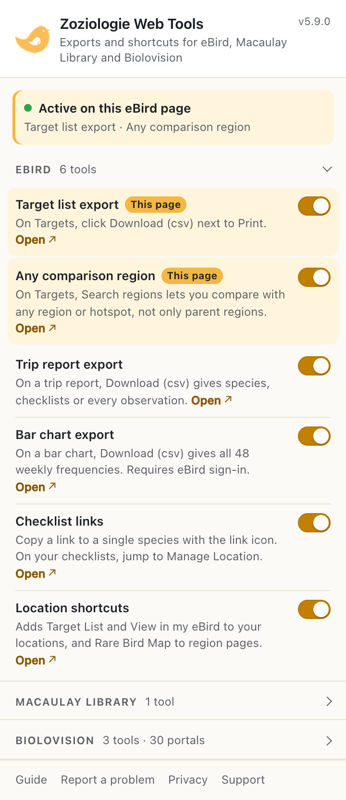
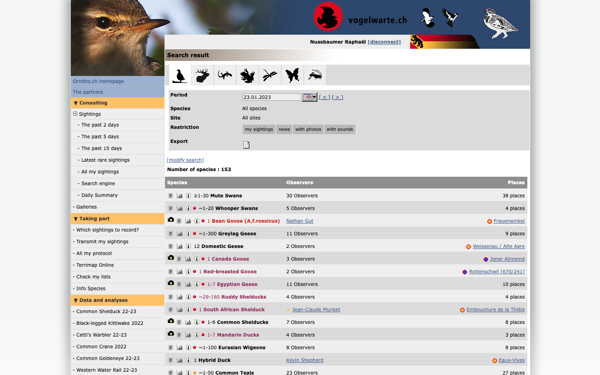

# Zoziologie Web Tools

A browser extension for Chrome and Firefox with export and navigation tools for eBird, Macaulay Library, and Biolovision (ornitho, faune-france and regional portals).

Source: [Zoziologie/zoziologie-web-tools](https://github.com/Zoziologie/zoziologie-web-tools). See [CHANGELOG.md](CHANGELOG.md) for release notes.

- [Zoziologie Web Tools](#zoziologie-web-tools)
  - [How to install?](#how-to-install)
  - [Toolbar menu and settings](#toolbar-menu-and-settings)
  - [eBird](#ebird)
    - [Export Target as CSV](#export-target-as-csv)
    - [Search for Region as target](#search-for-region-as-target)
    - [Export Trip report as CSV](#export-trip-report-as-csv)
      - [Species Level](#species-level)
      - [Observation Level](#observation-level)
      - [Checklist Level](#checklist-level)
    - [Export Barchart](#export-barchart)
    - [Checklist: link to a species and Manage location](#checklist-link-to-a-species-and-manage-location)
    - [Download photos and sounds](#download-photos-and-sounds)
  - [Biolovision](#biolovision)
    - [Export Species List](#export-species-list)
    - [Export Summary](#export-summary)
    - [Export List](#export-list)

## How to install?

Install the extension directly from the [Chrome Web Store](https://chrome.google.com/webstore/detail/zoziologie/ikoemgmlmapdnjkphgficpdlkfiepodh)!

The Chrome Web Store version also works in Microsoft Edge, Brave and other Chromium browsers.

**Firefox** (140 or newer) is supported from version 5.9.0: install it from [Firefox Add-ons](https://addons.mozilla.org/firefox/addon/zoziologie-web-tools/) once Mozilla's review is complete, or see [DEVELOPMENT.md](DEVELOPMENT.md#firefox) to load it yourself.

## Toolbar menu and settings

Click the Zoziologie bird in the browser toolbar (pin it from the puzzle-piece menu in Chrome) to see:

- **On this page**: whether the extension is active in the current tab and which tools are available there. If the tab was open before installing or updating, or if the browser blocks the site, the menu offers a one-click reload or access request.
- **Every tool, grouped by website**, with a one-line explanation, a link to the page where it appears and a switch to turn it off. Changes apply after reloading the page.

Settings follow your browser profile, and are synced if browser sync is on. Messages, such as the number of downloaded rows or an error, appear briefly at the bottom right of the page.

## eBird

### Export Target as CSV

Export your [Target](https://ebird.org/targets) list into a [comma-separated value (csv)](https://en.wikipedia.org/wiki/Comma-separated_values) using the new button "Download (csv)" next to "Print". The exported table contains the following columns:

| `rank` | `speciesCode` | `commonName` | `sciName`       | `frequency` | `exoticCategory` \* |
| ------ | ------------- | ------------ | --------------- | ----------- | ------------------- |
| 1      | brant         | Brent Goose  | Branta bernicla | 1.77%       | Native              |

\* one of `Native`, `Naturalized`, `Provisional`, `Escapee`. Note that hybrids are identifiable from `commonName`.

### Search for Region as target

By default, in the target page, you can only search for parent region in the "For your: " list. With this extension, you can now search for any region. This is specifically useful when search target at a specific hotspot for its parent region.

### Export Trip report as CSV

Export your [trip report](https://ebird.org/mytripreports) into a csv using the new button "Download (csv)" next to share and edit. Make sure to select the correct "DATA FOR:" according to what you want to download. There are three possible export:

#### Species Level

Each row correspond to a species.

| speciesCode | category | commonName     | sciName          | numIndividuals | numChecklists | numPhotos | numAudio | numVideo | isLifer | numMedia | exoticCategory | isPhotoLifer | isAudioLifer |
| ----------- | -------- | -------------- | ---------------- | -------------- | ------------- | --------- | -------- | -------- | ------- | -------- | -------------- | ------------ | ------------ |
| ostric2     | species  | Common Ostrich | Struthio camelus | 9              | 2             | 0         | 0        | 0        | FALSE   | 0        |                | FALSE        | FALSE        |

#### Observation Level

Each row correspond to a observations, which is similar to when clicking on "showing all details".

| _same as species level_ | subId      | obsDt            | locName                                              | howMany |
| ----------------------- | ---------- | ---------------- | ---------------------------------------------------- | ------- |
| _same as species level_ | S212383195 | 08.02.2025 10:20 | Dassenberg Drive, Western Cape, ZA (-33.463, 18.445) | 6       |

#### Checklist Level

Each row correspond to a checklist, similar to the checklists view

| locId     | subId      | numSpecies | obsDt     | obsTime | isoObsDate       | subID      | name                                                           | latitude    | longitude  | countryCode | countryName  | subnational1Name | subnational1Code | isHotspot | locName                                                        | hierarchicalName                                                                 | locID     | lat         | lng        |
| --------- | ---------- | ---------- | --------- | ------- | ---------------- | ---------- | -------------------------------------------------------------- | ----------- | ---------- | ----------- | ------------ | ---------------- | ---------------- | --------- | -------------------------------------------------------------- | -------------------------------------------------------------------------------- | --------- | ----------- | ---------- |
| L40063346 | S212444111 | 1          | 08.Feb.25 | 18:25   | 08.02.2025 18:25 | S212444111 | West Coast Road, Cape Town, Western Cape, ZA (-33.586, 18.399) | -33.5855343 | 18.3994637 | ZA          | South Africa | Western Cape     | ZA-WC            | FALSE     | West Coast Road, Cape Town, Western Cape, ZA (-33.586, 18.399) | West Coast Road, Cape Town, Western Cape, ZA (-33.586, 18.399), Western Cape, ZA | L40063346 | -33.5855343 | 18.3994637 |

### Export Barchart

Export a [barchart](https://ebird.org/GuideMe?cmd=changeLocation) data into a csv using the new button "Download (csv)" on top of the table.

First row is the normalization factor (i.e., number of checklists). There are 48 periods: 4 per months.

| `speciesCode` | `category` | `commonName`     | `sciName`     | `exoticCategory` | `Jan1` | `Jan2` | `...` | `Dec4` |
| ------------- | ---------- | ---------------- | ------------- | ---------------- | ------ | ------ | ----- | ------ |
|               |            |                  |               |                  | 247    | 259    | ...   | 257    |
| bahgoo        | species    | Bar-headed Goose | Anser indicus | N                | 0      | 0      | ...   | 0      |

### Checklist: link to a species and Manage location

- **Anchor link to species**: To share a specific sighting within your checklist, click on the link icon at the end of the line to copy the url of this entry on your clipboard. When opening this link, the page will automically scroll to this sighting.
- **Manage location** (not visible on screenshot below): A new button, next to "Edit Location" will help you to nagivate to the Location page directly.

### Download photos and sounds

Download any photo on the Macaulay Library at 2400 px wide resolution (the original is only available to the author) with the new "Download 2400px" button. On sound pages, "Download MP3" gets the recording.

Files are saved under their Macaulay number, for example `ML664758856.jpg`, once you click **Allow downloads** under Media download in the toolbar menu (a one-time browser permission). Until then, the button opens the file in a new tab.

## Biolovision

Works on [faune-france.org](https://www.faune-france.org/) and its regional portals (faune-aura, faune-bfc, faune-bretagne, faune-occitanie, faune-paysdelaloire, …), ornitho.ch, .de, .at, .it, .cat, .eus, .lu, .pl, dabasdati.ornitho.lv and data.biolovision.net. The full list is in the toolbar menu. Exports are named after the site, the kind of list and the date, for example `ornitho.ch_observations_2026-11-18.csv`.

The extension also tidies the layout (hides banners and slideshows, puts the search engine first in the menu). Turn this off in the toolbar menu if you prefer the original layout.

### Export Species List

Create csv files from Biolovision **Specie List** (`m_id=94`) pages using the csv button on the export row. This output page is selected on the last tab of the **search engine** page (`m_id=8`). The exported table contains the following columns:

| `number` | `common_name` | `scientific_name` | `latest_date` | `breeding` | `link_observation`                                                                                                                                                                                                                                                                                          | `link_stat`                                                                    | `link_info`                                                                                  |
| -------- | ------------- | ----------------- | ------------- | ---------- | ----------------------------------------------------------------------------------------------------------------------------------------------------------------------------------------------------------------------------------------------------------------------------------------------------------- | ------------------------------------------------------------------------------ | -------------------------------------------------------------------------------------------- |
| 31       | Greylag Goose | Anser anser       | 06.01.2020    | certain    | <https://www.ornitho.ch/index.php?m_id=94&showback=stor&p_c=5&p_cc=-1&sp_tg=1&sp_DateSynth=02.06.2020&sp_DChoice=offset&sp_DOffset=5&sp_SChoice=species&sp_S=60&sp_PChoice=canton&sp_cC=000100110000000000000011001001100000000000000000000&sp_FChoice=list&sp_FDisplay=DATE_PLACE_SPECIES&sp_DFormat=DESC> | <https://www.ornitho.ch/index.php?m_id=81&frmSpecies=60&sp_tg=1&showback=stor> | <https://www.ornitho.ch/index.php?m_id=15&showback=stor&backlink=skip&frmSpecies=60&sp_tg=1> |

### Export Summary

Create CSV files from Biolovision **Summary** (`m_id=32`) pages using the csv button on the export row. This output page is selected on the last tab of the **search engine** page (`m_id=8`). The exported table contains the following column:

| `number` | `common_name` | `observers` | `place`  | `link_photo`                                                                                        | `link_observations`                                                                                                                                                                                                                                                                                                                 | `link_stat`                                                                             | `link_info` |
| -------- | ------------- | ----------- | -------- | --------------------------------------------------------------------------------------------------- | ----------------------------------------------------------------------------------------------------------------------------------------------------------------------------------------------------------------------------------------------------------------------------------------------------------------------------------- | --------------------------------------------------------------------------------------- | ----------- |
| ~40      | Greylag Geese | 2 Observers | 2 places | <https://www.ornitho.ch/index.php?m_id=15&showback=stor&backlink=skip&y=2020&frmSpecies=60&sp_tg=1> | <https://www.ornitho.ch/index.php?m_id=94&showback=stor&p_c=5&p_cc=-1&sp_tg=1&sp_DateSynth=01.06.2020&sp_DChoice=range&sp_DFrom=01.06.2020&sp_DTo=01.06.2020&sp_SChoice=species&sp_S=60&sp_PChoice=canton&sp_cC=000100110000000000000011001001100000000000000000000&sp_FChoice=list&sp_FDisplay=DATE_PLACE_SPECIES&sp_DFormat=DESC> | <https://www.ornitho.ch/index.php?m_id=81&frmSpecies=60&showback=stor&cDate=2020-06-01> |

### Export List

Create CSV files from Biolovision **List** (`m_id=94`) pages using the csv button on the export row. This output page is selected on the last tab of the **search engine** page (`m_id=8`). The exported table contains the following column:

| `date`   | `place`                                | `place_link`                                                  | `number` | `common_name`     | `scientific_name`  | `remark`                                  |
| -------- | -------------------------------------- | ------------------------------------------------------------- | -------- | ----------------- | ------------------ | ----------------------------------------- |
| 06.01.24 | Widensolen (village) / Widensolen (68) | <https://www.faune-grandest.org/index.php?m_id=52&id=1153273> | 2        | Bécasses des bois | Scolopax rusticola | Remarque :observation de mon salon en vol |

_No screen shot_

## Development

See [DEVELOPMENT.md](DEVELOPMENT.md) for the file layout, automated checks, manual verification, and release steps. The extension runs directly from this repository; no build step or runtime dependencies are required.

Load a local copy from `chrome://extensions`: enable **Developer mode**, click **Load unpacked**, and select this folder. After editing, reload the extension and refresh the affected website tab.

CSV exports use UTF-8 with a BOM, standard quoted fields, and CRLF record separators. Commas, quotes, newlines, and non-ASCII names are preserved. Single-result exports are supported. Trip exports include columns appearing in later rows, so optional observation fields are not lost. Biolovision list exports preserve the site's displayed date text rather than guessing a date from the browser's locale; remarks retain their original punctuation and line breaks.
