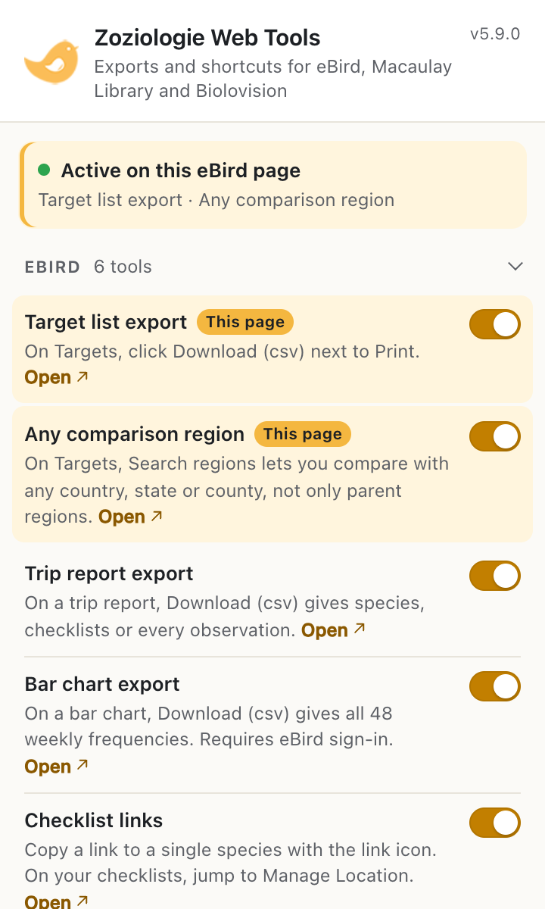
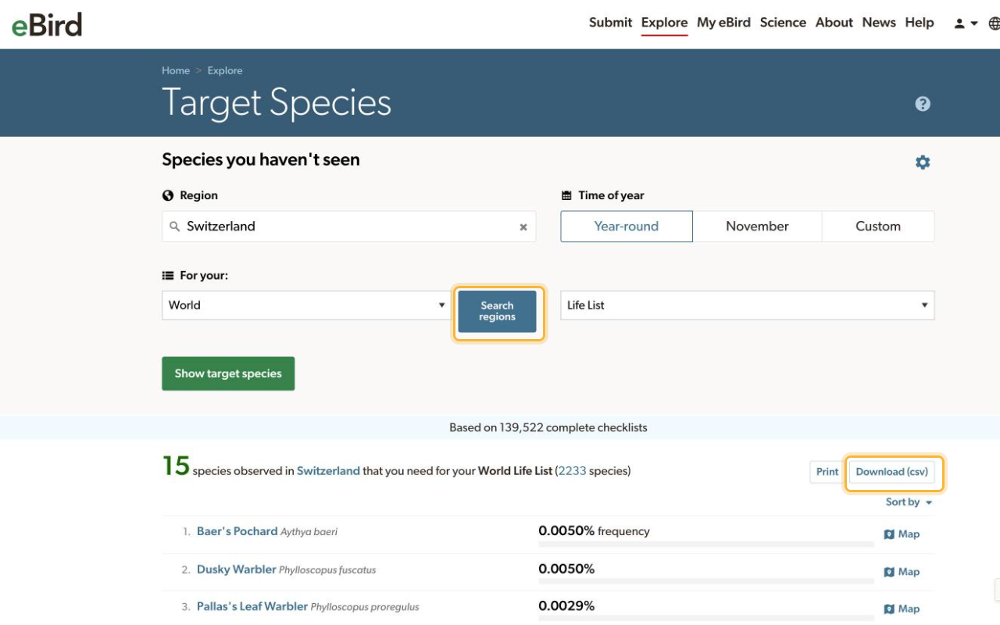
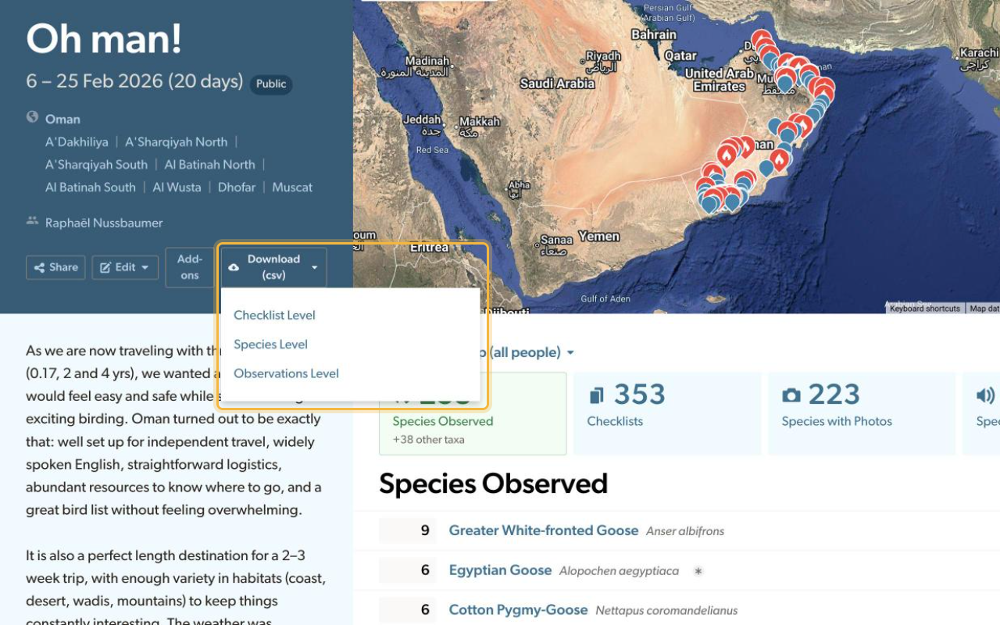
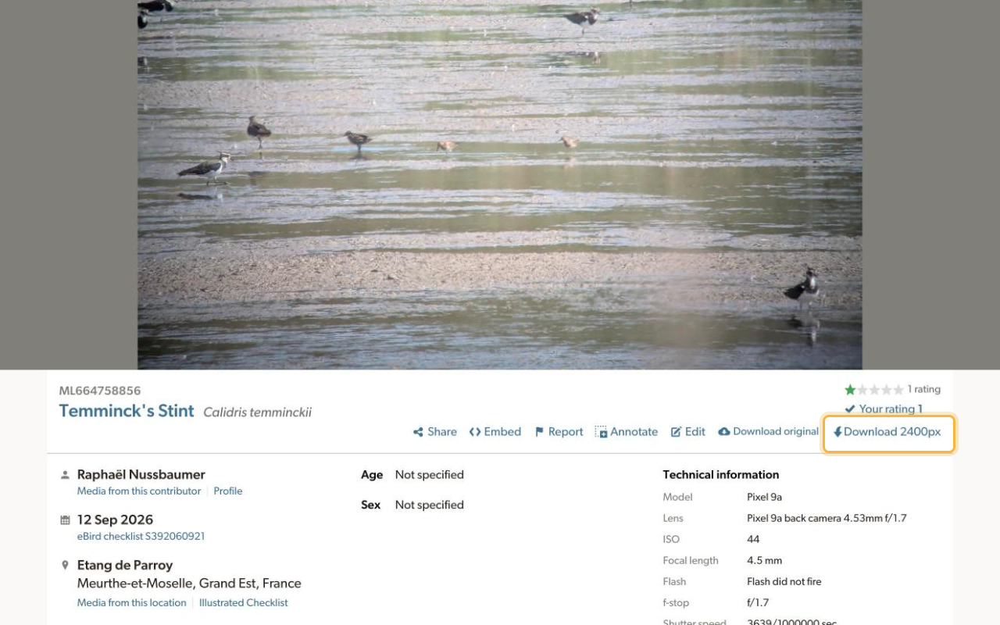
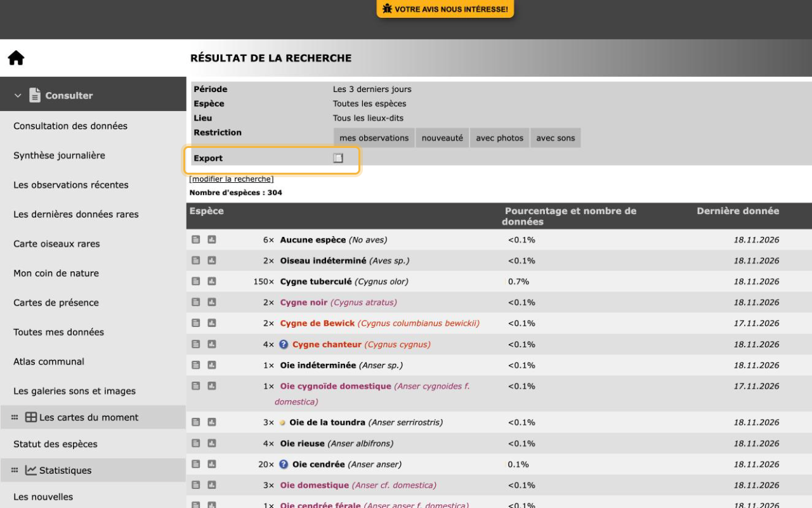

# Zoziologie Web Tools

A browser extension for Chrome and Firefox with export and navigation tools for eBird, Macaulay Library, and Biolovision (ornitho, faune-france and regional portals).

See [CHANGELOG.md](CHANGELOG.md) for release notes and [PRIVACY.md](PRIVACY.md) for how data is handled. Released under the [MIT License](LICENSE).

- [How to install?](#how-to-install)
- [Toolbar menu and settings](#toolbar-menu-and-settings)
- [eBird](#ebird)
  - [Export Target as CSV](#export-target-as-csv)
  - [Compare with any region](#compare-with-any-region)
  - [Export Trip report as CSV](#export-trip-report-as-csv)
  - [Export Barchart](#export-barchart)
  - [Checklist: link to a species and Manage location](#checklist-link-to-a-species-and-manage-location)
  - [Location and region shortcuts](#location-and-region-shortcuts)
  - [Download photos and sounds](#download-photos-and-sounds)
- [Biolovision](#biolovision)
  - [Export Species List](#export-species-list)
  - [Export Summary](#export-summary)
  - [Export List](#export-list)
- [CSV format](#csv-format)
- [Development](#development)

## How to install?

Install the extension directly from the [Chrome Web Store](https://chrome.google.com/webstore/detail/zoziologie/ikoemgmlmapdnjkphgficpdlkfiepodh)!

The Chrome Web Store version also works in Microsoft Edge, Brave and other Chromium browsers.

**Firefox** (140 or newer) is supported from version 5.9.0: install it from [Firefox Add-ons](https://addons.mozilla.org/firefox/addon/zoziologie-web-tools/) once Mozilla's review is complete, or see [DEVELOPMENT.md](DEVELOPMENT.md#firefox) to load it yourself.

## Toolbar menu and settings

Click the Zoziologie bird in the browser toolbar (pin it from the puzzle-piece menu in Chrome) to see:

- **On this page**: whether the extension is active in the current tab and which tools are available there. If the tab was open before installing or updating, or if the browser blocks the site, the menu offers a one-click reload or access request.
- **Every tool, grouped by website**, with a one-line explanation, a link to the page where it appears and a switch to turn it off. Changes apply after reloading the page.

Settings follow your browser profile, and are synced if browser sync is on. Messages, such as the number of downloaded rows or an error, appear briefly at the bottom right of the page.

## eBird

### Export Target as CSV

Export your [Target](https://ebird.org/targets) list into a [comma-separated value (csv)](https://en.wikipedia.org/wiki/Comma-separated_values) using the new button "Download (csv)" next to "Print". The exported table contains the following columns:

| `rank` | `speciesCode` | `commonName` | `sciName`       | `frequency` | `exoticCategory` \* |
| ------ | ------------- | ------------ | --------------- | ----------- | ------------------- |
| 1      | brant         | Brent Goose  | Branta bernicla | 1.77%       | Native              |

\* one of `Native`, `Naturalized`, `Provisional`, `Escapee`. Note that hybrids are identifiable from `commonName`.

### Compare with any region

On the Targets page, the "For your:" list only offers the parent regions of the selected region. The new "Search regions" button lets you pick any country, state or county instead, for example the species of a hotspot you still need for your county list.

### Export Trip report as CSV

Export your [trip report](https://ebird.org/mytripreports) into a CSV using the new "Download (csv)" button next to Share and Edit. Select the right "DATA FOR:" first: the export follows it. There are three levels:

#### Species Level

Each row corresponds to a species.

| speciesCode | category | commonName     | sciName          | numIndividuals | numChecklists | numPhotos | numAudio | numVideo | isLifer | numMedia | exoticCategory | isPhotoLifer | isAudioLifer |
| ----------- | -------- | -------------- | ---------------- | -------------- | ------------- | --------- | -------- | -------- | ------- | -------- | -------------- | ------------ | ------------ |
| ostric2     | species  | Common Ostrich | Struthio camelus | 9              | 2             | 0         | 0        | 0        | FALSE   | 0        |                | FALSE        | FALSE        |

#### Observation Level

Each row corresponds to an observation, as shown by "Show all details".

| _same as species level_ | subId      | obsDt            | locName                                              | howMany |
| ----------------------- | ---------- | ---------------- | ---------------------------------------------------- | ------- |
| _same as species level_ | S212383195 | 08.02.2025 10:20 | Dassenberg Drive, Western Cape, ZA (-33.463, 18.445) | 6       |

#### Checklist Level

Each row corresponds to a checklist, as in the checklists view.

| locId     | subId      | numSpecies | obsDt     | obsTime | isoObsDate       | subID      | name                                                           | latitude    | longitude  | countryCode | countryName  | subnational1Name | subnational1Code | isHotspot | locName                                                        | hierarchicalName                                                                 | locID     | lat         | lng        |
| --------- | ---------- | ---------- | --------- | ------- | ---------------- | ---------- | -------------------------------------------------------------- | ----------- | ---------- | ----------- | ------------ | ---------------- | ---------------- | --------- | -------------------------------------------------------------- | -------------------------------------------------------------------------------- | --------- | ----------- | ---------- |
| L40063346 | S212444111 | 1          | 08.Feb.25 | 18:25   | 08.02.2025 18:25 | S212444111 | West Coast Road, Cape Town, Western Cape, ZA (-33.586, 18.399) | -33.5855343 | 18.3994637 | ZA          | South Africa | Western Cape     | ZA-WC            | FALSE     | West Coast Road, Cape Town, Western Cape, ZA (-33.586, 18.399) | West Coast Road, Cape Town, Western Cape, ZA (-33.586, 18.399), Western Cape, ZA | L40063346 | -33.5855343 | 18.3994637 |

### Export Barchart

Export [bar chart](https://ebird.org/GuideMe?cmd=changeLocation) data into a CSV using the new "Download (csv)" button above the table (eBird sign-in required).

The first row is the normalization factor (the number of checklists). There are 48 periods: 4 per month.

| `speciesCode` | `category` | `commonName`     | `sciName`     | `exoticCategory` | `Jan1` | `Jan2` | `...` | `Dec4` |
| ------------- | ---------- | ---------------- | ------------- | ---------------- | ------ | ------ | ----- | ------ |
|               |            |                  |               |                  | 247    | 259    | ...   | 257    |
| bahgoo        | species    | Bar-headed Goose | Anser indicus | N                | 0      | 0      | ...   | 0      |

### Checklist: link to a species and Manage location

- **Link to a species**: to share a specific sighting in a checklist, click the link icon at the end of its line. The address of that entry is copied to your clipboard, and opening it scrolls straight to the sighting.
- **Manage location** (on your own checklists, not visible in the screenshot below): a new button next to "Edit Location", and an entry in the checklist tools menu, open the location's management page directly.

### Location and region shortcuts

- On your location pages (Manage location), the menu gains **Target List** and **View in my eBird** for that location.
- On region pages, the menu gains **Rare Bird Map**, which opens the [Global Rare eBird](https://zoziologie.raphaelnussbaumer.com/global-rare-ebird/) map for the country (or US state / Canadian province).

### Download photos and sounds

Download any photo on the Macaulay Library at 2400 px wide resolution (the original is only available to the author) with the new "Download 2400px" button. On sound pages, "Download MP3" gets the recording.

Files are saved under their Macaulay number, for example `ML664758856.jpg`, once you click **Allow downloads** under Media download in the toolbar menu (a one-time browser permission). Until then, the button opens the file in a new tab.

## Biolovision

Works on [faune-france.org](https://www.faune-france.org/) and its regional portals (faune-aura, faune-bfc, faune-bretagne, faune-occitanie, faune-paysdelaloire, …), ornitho.ch, .de, .at, .it, .cat, .eus, .lu, .pl, dabasdati.ornitho.lv and data.biolovision.net. The full list is in the toolbar menu. Exports are named after the site, the kind of list and the date, for example `ornitho.ch_observations_2026-11-18.csv`.

The extension also tidies the layout (hides banners and slideshows, puts the search engine first in the menu). Turn this off in the toolbar menu if you prefer the original layout.

### Export Species List

Download the **species list** output of the search engine (`m_id=8`, last tab; the result address contains `sp_FChoice=species`) with the CSV button in the Export row. The table contains:

| `number` | `common_name` | `scientific_name` | `latest_date` | `breeding` | `link_observation`                                                                                                                                                                                                                                                                                          | `link_stat`                                                                    | `link_info`                                                                                  |
| -------- | ------------- | ----------------- | ------------- | ---------- | ----------------------------------------------------------------------------------------------------------------------------------------------------------------------------------------------------------------------------------------------------------------------------------------------------------- | ------------------------------------------------------------------------------ | -------------------------------------------------------------------------------------------- |
| 31       | Greylag Goose | Anser anser       | 06.01.2020    | certain    | <https://www.ornitho.ch/index.php?m_id=94&showback=stor&p_c=5&p_cc=-1&sp_tg=1&sp_DateSynth=02.06.2020&sp_DChoice=offset&sp_DOffset=5&sp_SChoice=species&sp_S=60&sp_PChoice=canton&sp_cC=000100110000000000000011001001100000000000000000000&sp_FChoice=list&sp_FDisplay=DATE_PLACE_SPECIES&sp_DFormat=DESC> | <https://www.ornitho.ch/index.php?m_id=81&frmSpecies=60&sp_tg=1&showback=stor> | <https://www.ornitho.ch/index.php?m_id=15&showback=stor&backlink=skip&frmSpecies=60&sp_tg=1> |

### Export Summary

Download the **summary** output of the search engine (`sp_FChoice=synth`) with the CSV button in the Export row. The table contains:

| `number` | `common_name` | `observers` | `place`  | `link_photo`                                                                                        | `link_observations`                                                                                                                                                                                                                                                                                                                 | `link_stat`                                                                             | `link_info` |
| -------- | ------------- | ----------- | -------- | --------------------------------------------------------------------------------------------------- | ----------------------------------------------------------------------------------------------------------------------------------------------------------------------------------------------------------------------------------------------------------------------------------------------------------------------------------- | --------------------------------------------------------------------------------------- | ----------- |
| ~40      | Greylag Geese | 2 Observers | 2 places | <https://www.ornitho.ch/index.php?m_id=15&showback=stor&backlink=skip&y=2020&frmSpecies=60&sp_tg=1> | <https://www.ornitho.ch/index.php?m_id=94&showback=stor&p_c=5&p_cc=-1&sp_tg=1&sp_DateSynth=01.06.2020&sp_DChoice=range&sp_DFrom=01.06.2020&sp_DTo=01.06.2020&sp_SChoice=species&sp_S=60&sp_PChoice=canton&sp_cC=000100110000000000000011001001100000000000000000000&sp_FChoice=list&sp_FDisplay=DATE_PLACE_SPECIES&sp_DFormat=DESC> | <https://www.ornitho.ch/index.php?m_id=81&frmSpecies=60&showback=stor&cDate=2020-06-01> |

### Export List

Download the **list** output of the search engine (`sp_FChoice=list`) with the CSV button in the Export row. The table contains:

| `date`   | `place`                                | `place_link`                                                  | `number` | `common_name`     | `scientific_name`  | `remark`                                  |
| -------- | -------------------------------------- | ------------------------------------------------------------- | -------- | ----------------- | ------------------ | ----------------------------------------- |
| 06.01.24 | Widensolen (village) / Widensolen (68) | <https://www.faune-grandest.org/index.php?m_id=52&id=1153273> | 2        | Bécasses des bois | Scolopax rusticola | Remarque :observation de mon salon en vol |

## CSV format

CSV exports use UTF-8 with a BOM, comma separators, standard quoted fields, and CRLF record separators, so they open correctly in R, Python, QGIS and spreadsheets. Commas, quotes, newlines, and non-ASCII names are preserved. Trip exports include columns appearing in later rows, so optional observation fields are not lost. Biolovision list exports keep the site's displayed date text rather than guessing a date from the browser's locale; remarks keep their original punctuation and line breaks.

## Development

The extension runs directly from this repository, with no build step or runtime dependencies. Load a local copy from `chrome://extensions` (enable **Developer mode**, click **Load unpacked**, select this folder) or from `about:debugging` in Firefox. After editing, reload the extension and refresh the affected tab.

See [DEVELOPMENT.md](DEVELOPMENT.md) for the file layout, tests (`npm run check`), Firefox linting, store screenshots (`npm run screenshots`) and release steps.
